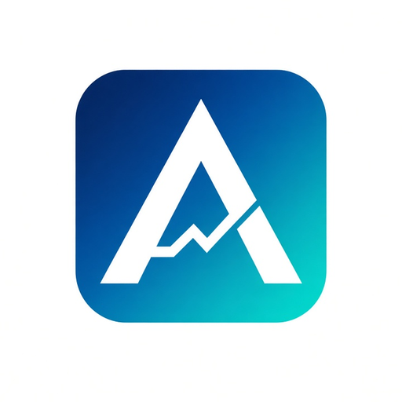

<p align="center"></p>

# Afriref fleet — cited government reference data MCP servers

Seven remote MCP servers (Streamable HTTP) serving official government reference data as cited JSON, one per region:

| Server | Endpoint | Coverage | Free evaluation country |
|---|---|---|---|
| afriref | https://afriref.dev/mcp | 34 African countries | Ghana (GH) |
| euroref | https://euroref.dev/mcp | 35 European countries | Germany (DE) |
| asiaref | https://asiaref.dev/mcp | 28 Asian countries | Japan (JP) |
| latamref | https://latamref.dev/mcp | 22 Latin American countries | Brazil (BR) |
| usaref | https://usaref.dev/mcp | 10 North American countries | USA (US) |
| mearef | https://mearef.dev/mcp | 9 Middle Eastern countries | UAE (AE) |
| ausref | https://ausref.dev/mcp | 8 Australasian countries | Australia (AU) |

129 countries in total. Every value carries its official source URL, effective date, last_confirmed date and a stale flag.

## What it answers
Income and corporate tax, VAT/GST (with bands), CPI inflation, central-bank policy rate, minimum wage, public holidays (incl. sub-national), business days, official exchange rates, statutory interest, social contributions. Computed answers: VAT breakdown, minimum-wage compliance, working days, settlement date, income tax, statutory interest, payroll and employment cost.

## Tools
Free: list_series (compact index; pass country for detail), get_public_holidays, get_changes, get_calendar, verify_answer_receipt, register_alert.
Paid: get_series, get_series_history, check_minimum_wage, compute_vat, count_working_days, settlement_date, compute_income_tax, compute_statutory_interest, compute_payroll, compute_employment_cost.

## Pricing and how to pay
- Free: every series of the evaluation country; free trial of 3 computed-answer calls per day per IP (HTTP header X-Free-Trial: 1).
- Pay per call over x402 (USDC on Base): $0.005 per series value, $0.02–$0.10 per computed answer. No account.
- Or buy prepaid card credit at https://afriref.dev/pricing (one key works on all seven servers, same per-call price) and pass it as api_key.

## Connect
```json
{ "mcpServers": { "afriref": { "url": "https://afriref.dev/mcp" } } }
```
Swap the host for any other region.

## Links
Docs https://afriref.dev/docs · OpenAPI https://afriref.dev/openapi.json · llms.txt https://afriref.dev/llms.txt · Terms https://afriref.dev/terms

Operated by 3L Group Consulting (PTY) LTD. Support: api@3l-groupconsulting.co.za
